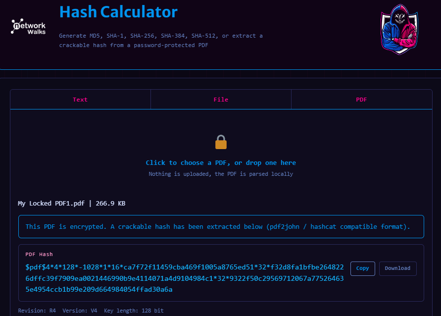
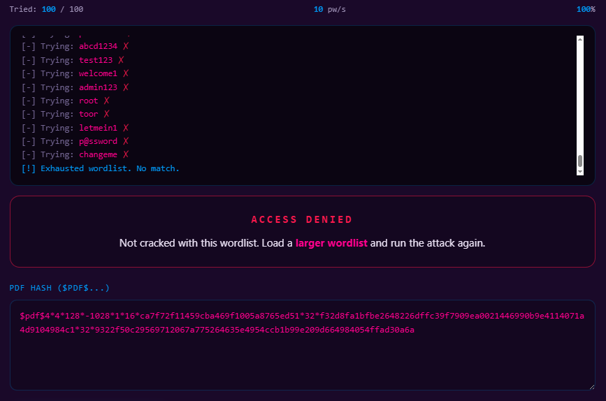
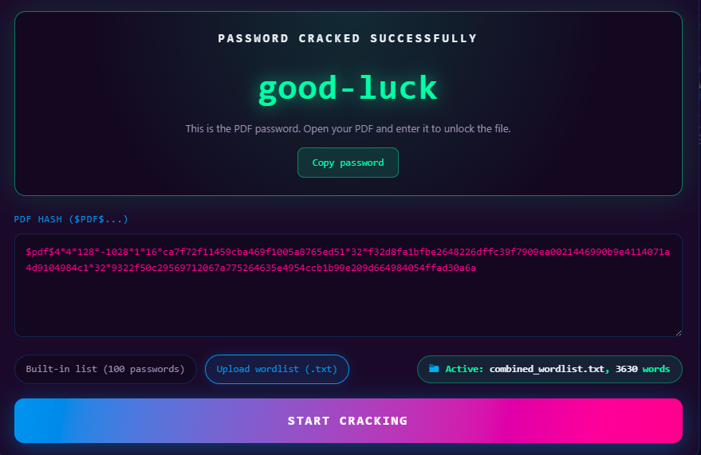
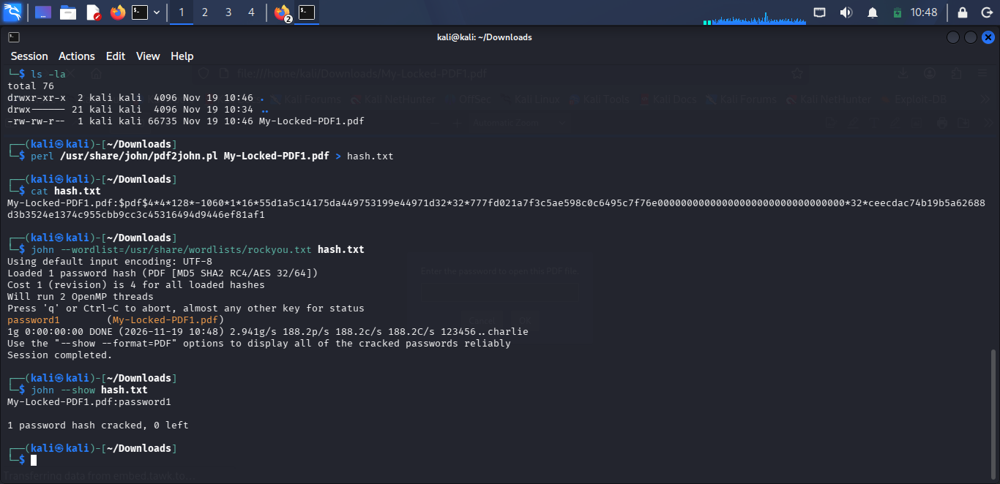
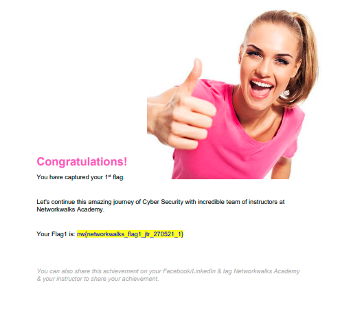

# Week 3 — Password Cracking Project (JTR + NetworkWalks Tools)

**Student:** Bwalya Adrian Mange
**Target file:** `My Locked PDF1.pdf`
**Flags captured:**
- Module 1 (JTR): `nw{networkwalks_flag1_jtr_270521_1}`
- Module 2 (NetworkWalks Tools): `nw{cybersecurity_flag_captured_2608}`

---

## Module 2 — Password Cracking with NetworkWalks Tools

**Tools used:** NetworkWalks Hash Calculator, NetworkWalks Password Cracker

### Step 1 — Extract the hash
Uploaded `My Locked PDF1.pdf` to the Hash Calculator, which produced the crackable `$pdf$...` hash.

### Step 2 — First attempt fails (built-in wordlist too small)
Running the Password Cracker's built-in 100-word list exhausted with no match.

### Step 3 — Retry with a larger wordlist
Uploaded a larger custom wordlist (3,630 words) via the "Upload wordlist (.txt)" option. The password cracked successfully.

**Cracked password:** `good-luck`

### Step 4 — Unlock the PDF and capture the flag
Opened the PDF with the cracked password and captured Flag1.

**Flag1:** `nw{cybersecurity_flag_captured_2608}`

---

## Module 1 — Password Cracking with JTR

**Tools used:** John the Ripper (JTR), pdf2john, Kali Linux terminal

> Note: the troubleshooting steps below (locating the file, fixing the filename mismatch, etc.) are documented in the **Challenges** section rather than with screenshots, since those intermediate steps weren't captured as images — only the final successful crack and flag were.

### Step 1 — Successful hash extraction and crack
After resolving the setup issues described below, `pdf2john` produced a valid hash, and John the Ripper cracked it against `rockyou.txt`.

**Cracked password:** `password1`

### Step 2 — Unlock the PDF and capture the flag
Opened the PDF with the cracked password and captured Flag1.

**Flag1:** `nw{networkwalks_flag1_jtr_270521_1}`

---

## Challenges

Module 1 took several attempts to get working on Kali before producing the result above. The main issues, in order:

1. **`pdf2john.pl` not found on PATH.** The script exists on Kali but isn't callable by name directly — it had to be located first and then run explicitly through `perl` with its full path (`/usr/share/john/pdf2john.pl`).
2. **Hash passed as a filename instead of a file.** An early `john` command accidentally passed the raw hash string as if it were a filename, which John tried (and failed) to open on disk. The fix was to make sure the hash was saved into a file first and point John at that file instead.
3. **Empty hash file.** After fixing the command syntax, `hash.txt` was still coming back empty. This turned out to be because `pdf2john` couldn't find the target PDF at all in the working directory.
4. **PDF not actually present on the Kali machine.** A search of the whole home directory turned up nothing — the PDF had only ever been downloaded on a different device (the one used for the browser-based NetworkWalks tool), not on Kali itself. It had to be downloaded again, this time inside Kali.
5. **Filename mismatch.** Once downloaded, the file ended up saved as `My-Locked-PDF1.pdf` (hyphens) rather than `My Locked PDF1.pdf` (spaces) — the name used in every earlier command. That mismatch was the actual root cause of steps 1–4 failing to find the file. Correcting the filename let `pdf2john` extract the hash properly, and John the Ripper cracked it against `rockyou.txt` on the first real attempt.

Once the hash was extracted correctly, the JTR Johnny GUI step confirmed the same password almost instantly, since it read from John's existing cracked-password cache.

---

## Summary

| Module | Tool | Cracked Password | Flag |
|---|---|---|---|
| Module 1 | JTR (John the Ripper) | `password1` | `nw{networkwalks_flag1_jtr_270521_1}` |
| Module 2 | NetworkWalks Hash Calculator + Password Cracker | `good-luck` | `nw{cybersecurity_flag_captured_2608}` |
